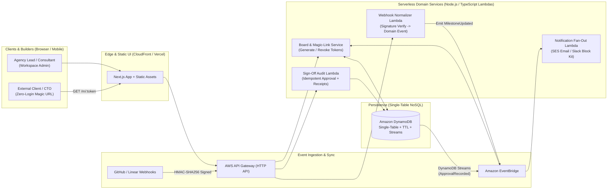

# Case Study: ShipLink — Zero-Login Capability-URL Client Status & Sign-Off Architecture

> **Author:** Sarwan Singh — Lead Software Engineer & Anthropic Certified Claude Architect (Associate)  
> **Companion Product:** `digital-lab/01-product-factory/02-products/shiplink`  
> **Architecture Pattern:** Phased Serverless Evolution (Zero-Cost Client-Side Capability Smoke Test $\rightarrow$ Event-Driven AWS Serverless Production)

---

## 1. Problem Statement & Architectural Context

Boutique software agencies, technical consultants, and engineering squads face an identity friction bottleneck: **non-technical clients and executive stakeholders refuse to create accounts or remember passwords** for internal delivery tools (`Jira`, `Linear`, `Asana`). Consequently, teams spend ~15–20% of weekly engineering/PM capacity assembling manual screenshots and Slack/email updates, while formal milestone sign-offs stay unrecorded.

### Core Design Constraints (FR & NFR)

| Requirement | Target Specification |
|---|---|
| **`FR-1` Zero-Login Client Access** | Clients view live project progress, inspect staging previews, and submit milestone approvals via a single magic URL without OAuth/passwords. |
| **`FR-2` Automated Dev-Event Sync (Phase 2)** | Ingest GitHub PR merges and Linear/Jira status transitions asynchronously to advance client-visible milestones automatically. |
| **`FR-3` Tamper-Evident Sign-Off Audit** | Every client approval or change request records immutable timestamp, IP/user-agent hash, and optional feedback note. |
| **`NFR-1` Phased FinOps Discipline** | **$0/month** during Phase 1 market validation (stateless edge); **< $10/month** at 50,000 monthly magic-link views in Phase 2 AWS Serverless. |
| **`NFR-2` Latency & Availability** | Client link resolution `< 120 ms` p95 globally via CDN/Edge caching + single-digit ms DynamoDB point reads. |
| **`NFR-3` Security (Capability URLs)** | High-entropy 128-bit+ unguessable URL capability tokens (`>= 22` base64url chars), separate read vs. approve scopes, optional expiry/revocation, zero secret leakage in referrer headers. |

---

## 2. System Architecture (Phased Evolution)

### Phase 1: $0 Validation Architecture (Static Edge + Compressed Fragment Capability State)
Before provisioning cloud databases, Phase 1 validates user demand and willingness-to-pay (`$0` AWS bill) by serializing board state into URL-safe Base64 inside the URL `#d=` fragment. Because browser URL fragments are **never transmitted to HTTP servers**, sensitive sprint titles stay out of edge access logs while still sharing identically across devices.

### Phase 2: Production AWS Event-Driven Serverless Architecture

---

## 3. DynamoDB Single-Table Data Model & Access Patterns

Designed for deterministic single-digit millisecond reads without cross-table joins or N+1 queries.

| Entity | Partition Key (`PK`) | Sort Key (`SK`) | `GSI1PK` (Workspace Index) | `GSI1SK` |
|---|---|---|---|---|
| **Workspace** | `WS#<workspaceId>` | `META` | `OWNER#<emailHash>` | `WS#<workspaceId>` |
| **Project Board** | `BOARD#<boardId>` | `META` | `WS#<workspaceId>` | `BOARD#<updatedAt>` |
| **Magic Capability Token** | `TOKEN#<sha256(rawToken)>` | `LINK` | `BOARD#<boardId>` | `TOKEN#<scope>` |
| **Milestone Item** | `BOARD#<boardId>` | `MS#<order>#<milestoneId>` | — | — |
| **Sign-Off Audit Event** | `BOARD#<boardId>` | `AUDIT#<isoTimestamp>#<uuid>` | — | — |
| **Smoke-Test / Pro Lead** | `LEAD#<emailHash>` | `WAITLIST#<ts>` | `TIER#<selectedTier>` | `LEAD#<ts>` |

### Core Access Patterns
1. **Resolve Client Magic Link (`< 10 ms`):** `GetItem(PK = TOKEN#sha256(token))` $\rightarrow$ validates `status == ACTIVE && expiresAt > now` $\rightarrow$ fetches `boardId` $\rightarrow$ `Query(PK = BOARD#<boardId>)` returning `META` + `MS#*` items in **one single partition query**.
2. **Idempotent Client Approval:** Conditional `UpdateItem` on `MS#*` (`attribute_not_exists(approvedAt)` or `version == expectedVersion`) + atomic `TransactWriteItems` appending an immutable `AUDIT#*` record.
3. **Revoke / Rotate Compromised Link:** `DeleteItem` or `status = REVOKED` on `TOKEN#<hash>` instantly invalidates access at the edge without touching board data.

---

## 4. Architecture Decision Records (ADRs)

### ADR-001: Capability URLs (Hashed Tokens) vs. Passwordless Email OTP Sessions
- **Context:** Traditional "passwordless" portals email a 6-digit OTP or magic login cookie, which breaks when a CEO forwards the link to a VP in Slack.
- **Decision:** Store **only the SHA-256 hash** of a 128-bit cryptographic URL token in DynamoDB (`TOKEN#<sha256>`), scoped to either `READ_APPROVE` (client) or `ADMIN` (creator), with instant revocation and `Referrer-Policy: no-referrer`.
- **Trade-off Accepted:** Anyone holding the URL can view the sprint card (acceptable for non-PII milestone progress); sensitive invoice/banking attachments are strictly excluded or gated behind optional 4-digit PIN challenge in Pro tier.

### ADR-002: URL-Fragment State (`#d=`) for Phase 1 Validation Before Provisioning AWS
- **Context:** Building DynamoDB + Cognito + Webhook infra before validating user demand creates weeks of sunk engineering cost.
- **Decision:** Launch Phase 1 as a pure static Next.js build encoding state into the URL fragment (`#d=`).
- **Outcome:** **$0/month cloud burn**, zero server PII exposure, instant cross-device sharing, and real user conversion telemetry before writing a single AWS Lambda handler.

### ADR-003: DynamoDB Single-Table Design over PostgreSQL (RDS/Aurora)
- **Context:** Workloads are overwhelmingly bursty point lookups (`GET /m/:token`) and ordered milestone queries per board—never ad-hoc multi-table BI analytics.
- **Decision:** DynamoDB On-Demand Single-Table + Streams.
- **Outcome:** Eliminates VPC cold-starts, RDS idle monthly minimums (~$15–$50/mo), and connection-pool exhaustion under traffic spikes (e.g., Show HN front page). Scales from `$0.00` idle to millions of reads seamlessly.

### ADR-004: Amazon EventBridge Decoupling for GitHub/Linear Webhooks & Notifications
- **Context:** GitHub/Linear webhooks enforce strict timeout windows (~3–10s), while downstream Slack/SES notifications and AI summary formatting can lag or fail transiently.
- **Decision:** Ingestion Lambda strictly validates HMAC-SHA256 webhook signatures, normalizes into a canonical domain event (`MilestoneSyncRequested`), emits to **EventBridge**, and returns `202 Accepted` in `< 50 ms`. Downstream consumers process with built-in retry + SQS Dead-Letter Queue (DLQ).

---

## 5. FinOps Cost Model (Phase 1 vs. Phase 2 Scale)

| Monthly Traffic Tier | Phase 1 (Static Edge) | Phase 2 (AWS Serverless Estimate) |
|---|---|---|
| **0 – 10,000 Views** *(Smoke Test)* | **$0.00 / mo** (Vercel/Cloudflare Free Tier) | ~$0.00 – $1.50 / mo (AWS Free Tier) |
| **50,000 Magic-Link Views + 5,000 Approvals** | **$0.00 / mo** | **~$3.80 – $6.50 / mo** (API GW + Lambda + DynamoDB On-Demand + SES) |
| **Gross Margin @ 50 Pro Teams ($39/mo = $1,950 MRR)** | N/A | **~99% infrastructure margin** |
